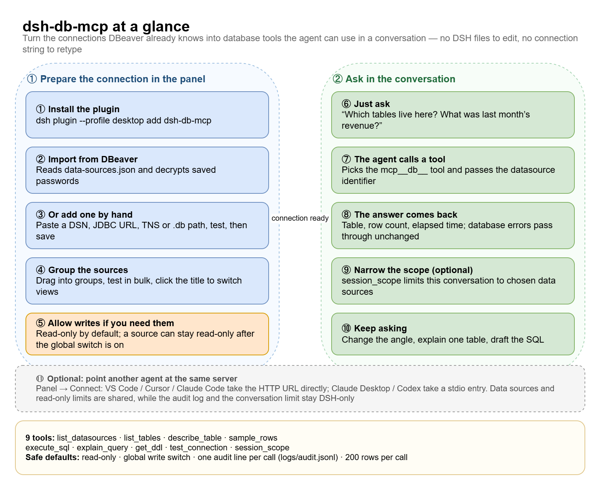
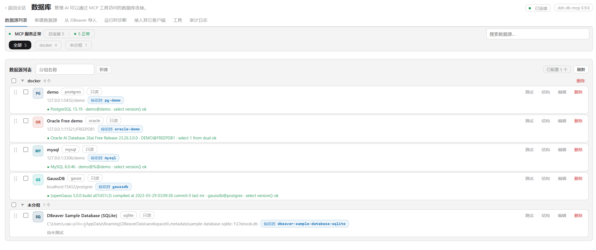

# dsh-db-mcp

[](LICENSE)
[](https://www.npmjs.com/package/dsh-db-mcp)
[](https://www.npmjs.com/package/dsh-db-mcp)
[](https://www.npmjs.com/package/dsh-db-mcp)

English | [中文](README.zh.md)

A [DSH](https://github.com/deepseek-ai/deepseek-harness) plugin that hands your
databases to the agent. Register a connection once, then just ask — the agent
queries it through MCP tools and answers in the conversation.

**The fastest path is the one you already walked:** import the connections DBeaver
already knows, saved passwords included, and skip typing anything.

## Three things you do not have to do

- **Do not retype connections.** The importer reads your DBeaver workspace
  (`data-sources.json`) and decrypts `credentials-config.json` with DBeaver's own
  key, so host, port, database, user **and the saved password** arrive together.
  Tick the boxes, click import, done. Existing endpoints are marked, so the same
  connection is never added twice.
- **Do not configure DSH.** The bundle inserts one Loader row. The plugin starts its
  own Python MCP server and registers the tools itself — no `dsh-mcp-client` row, no
  JSON to edit, no environment variable to export.
- **Do not prepare a Python environment.** No venv to create, no `pip install` to
  run by hand: the panel finds an interpreter, builds `.venv` and installs the driver
  packages from **Runtime → Install / repair dependencies**.

## How it works, on one page

Left: what you do in the panel. Right: what happens in the conversation once a
source exists.



## Screenshots

**The source list.** A health strip across the top, sources grouped the way you
grouped them, engine badges, the identifier each tool call needs, and a failed probe
stays inline with its full error and a copy button. The **Import from DBeaver** tab
sits right next to it.



## One set of sources, every DSH you run

The registry lives in `~/.dsh/db-mcp/` (`datasources.json` + `secrets.json`, mode
`0600`), not inside a profile. So:

- **Install it in the desktop app, the web UI, or both** — they read the same file,
  so a source imported once shows up everywhere.
- **Run several DSH windows at the same time.** Each instance starts its own Python
  service; the first takes the HTTP port and the next ones step to the following
  free port automatically, so nothing refuses to start.
- **Upgrade or reinstall without redoing the setup.** Sources, groups, settings and
  the audit log survive; only the plugin code is replaced.

## The same server, for your other agents

The panel publishes the identical MCP server over streamable HTTP. The **Connect**
tab shows the address (`http://127.0.0.1:8765/dsh-db-mcp`) and writes the entry for
you with one click:

| Client | Written as |
| ------ | ---------- |
| VS Code / VS Code Insiders | HTTP entry in `mcp.json` |
| Cursor | HTTP entry in `~/.cursor/mcp.json` |
| Claude Code | HTTP entry in `~/.claude.json` |
| Claude Desktop | stdio entry in `claude_desktop_config.json` |
| Codex CLI | `[mcp_servers.dsh-db-mcp]` in `~/.codex/config.toml` |

Point JetBrains AI or anything else that speaks MCP at the same URL and it works
too. Data sources, the read-only flag, the writable schemas and the DDL switch are
shared; the audit log, the tool list and the conversation-level limit stay inside
DSH. [The safety page](docs/safety.md#which-rules-follow-you-out-of-dsh) has the
line-by-line table; [clients.md](docs/clients.md) walks through the endpoint.

## Requirements

| | Needs |
| --- | --- |
| DSH | `>= 0.2.0-rc.2` (declared in `engines.dsh`) |
| Node.js | the runtime DSH itself ships (24.x). The plugin only uses `node:sqlite` — available from **22.5** — for the in-process SQLite probe; if it is missing, the Python driver covers SQLite and the panel says so |
| Python | **3.10 or newer** for the bundled server (`mcp`, `psycopg`, `oracledb` and `pydantic` all require 3.10+; tested on 3.13). The panel creates the venv; you only need an interpreter on `PATH` or set `pythonPath` in the plugin config |
| Database drivers | installed by the panel into that venv: `mcp`, `psycopg[binary]`, `py-opengauss`, `PyMySQL`, `oracledb`, `cryptography`. SQLite needs nothing extra |
| OS | Windows, macOS or Linux. Venv paths (`.venv/Scripts/python.exe` vs `.venv/bin/python`) and the DBeaver workspace location are detected per platform |

## Run

```sh
dsh plugin --profile desktop add dsh-db-mcp   # desktop app
dsh plugin --profile web add dsh-db-mcp       # web UI
```

`--profile` picks the profile to install into (`desktop` and `web` ship with DSH;
any other name is created on first use). Remove with
`dsh plugin --profile desktop remove dsh-db-mcp`.

Upgrading has its own traps — pnpm's metadata cache, its release cooldown, and
Windows holding the old files open. See [Updating from the app](docs/guide.md#updating-from-the-app);
if the app asks you to disable other configurations first, restart DSH and update
again (that releases the running app's hold on the bundle).

Then:

1. Sidebar → **Database**.
2. **Import from DBeaver** → tick the connections → **Import selected**.
3. Ask the agent something like *"which tables does my Chinook database have?"*

A connection whose password was never saved shows **no password**; open the source
once and type it — it goes to `secrets.json` and never comes back to the page.

Prefer to start from scratch? **New data source** takes one connection string
(`postgresql://user:pw@host:5432/db`, a JDBC URL, an Oracle TNS descriptor or a
`.db` path) and fills the form from it. A **Test** button next to **Save** logs in
for real before you commit the source.

## What the agent gets

| Tool | Purpose |
| ---- | ------- |
| `mcp__db__list_datasources` | registered sources: id, kind, target, read-only |
| `mcp__db__list_tables` | tables and views of a source |
| `mcp__db__describe_table` | columns, types, nullability, primary key |
| `mcp__db__sample_rows` | a few rows of a table |
| `mcp__db__execute_sql` | execute one statement — a query, or a write when that is allowed |
| `mcp__db__explain_query` | query plan |
| `mcp__db__get_ddl` | `CREATE TABLE` statement |
| `mcp__db__test_connection` | real login, `select 1`, server/user/schema |
| `mcp__db__session_scope` | limit this conversation to some sources, or lift the limit |

`datasource` is optional on all of them: omitted, the plugin falls back to the source
flagged `isDefault` (or the first one in the registry).
Queries run **in the conversation**; the panel is for managing connections, not a
SQL console. The **Tools** tab can hide the ones you never use — fewer distractions,
smaller tool list in the model's context.

## Safety

- **Read-only by default**, with four independent gates: a global write switch, a
  per-source flag, the schemas that source may write to, and a separate DDL switch.
  All must be open before a statement may write.
- **Writes are confined to chosen schemas.** Turning a source writable asks which
  schemas it may write to, one checkbox each; a statement aimed anywhere else is
  refused before it reaches the database. Reads stay unrestricted. The guard runs in
  the Python server, so the panel, the agent and the HTTP endpoint all obey it.
- **DDL is opt-in.** `create`, `alter`, `drop`, `truncate`, `rename`, `grant` and
  `revoke` are refused unless the source was granted DDL in that same dialog; the
  schemas above still bound where such a statement may land.
- **Passwords stay local, encrypted at rest.** `secrets.json` holds an AES-256-GCM
  envelope per source, the key lives beside it in `secret.key` (mode `0600`); no HTTP
  route ever returns a password, and the Python child receives a short environment
  allowlist rather than the whole DSH environment.
- **Every tool call is audited** to `logs/audit.jsonl` — tool, source, duration, row
  count, SQL. Result rows are never logged.
- **Nothing runs from the panel except catalog reads.** The structure browser only
  forwards `list_tables` and `describe_table`.

## Documentation

| Document | Contents |
| -------- | -------- |
| [docs/guide.md](docs/guide.md) | Panel walkthrough: install, connection strings, importing, groups, structure browser |
| [docs/safety.md](docs/safety.md) | The four gates, writable schemas, what still applies to an outside client |
| [docs/clients.md](docs/clients.md) | The HTTP endpoint, wiring other clients, the tools list |
| [docs/runtime.md](docs/runtime.md) | Runtime directory, Python dependencies, Docker test databases, troubleshooting |
| [docs/reference.md](docs/reference.md) | HTTP routes, tool contracts, registry and settings files, plugin config |
| [docs/development.md](docs/development.md) | Repository layout, hot reload, test suites, release flow |
| [docs/design-notes.md](docs/design-notes.md) | Historical design log (P1 → P7) and the decisions behind them |
| [docs/architecture.drawio](docs/architecture.drawio) | Three-page map: file layout, call graph, runtime picture |

## License

Apache License 2.0 — see [LICENSE](LICENSE).
