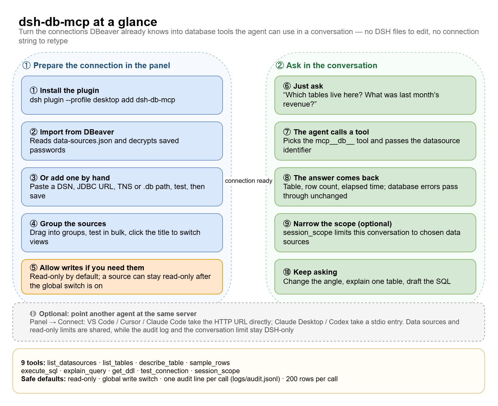
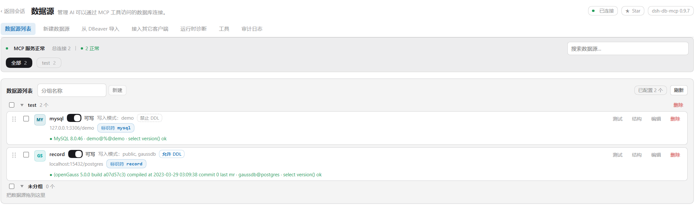

# dsh-db-mcp

[](LICENSE)
[](https://www.npmjs.com/package/dsh-db-mcp)
[](https://www.npmjs.com/package/dsh-db-mcp)
[](https://www.npmjs.com/package/dsh-db-mcp)

English | [中文](README.zh.md)

A [DSH](https://github.com/deepseek-ai/deepseek-harness) plugin that hands your
databases to the agent. Register a connection once, then just ask — the agent
queries it through MCP tools and answers in the conversation.

**The fastest path is the one you already walked:** import the connections DBeaver
already knows, saved passwords included, and skip typing anything.

## Four things you do not have to do

- **Do not retype connections.** The importer reads your DBeaver workspace
  (`data-sources.json`) and decrypts `credentials-config.json` with DBeaver's own
  key, so host, port, database, user **and the saved password** arrive together.
  Tick the boxes, click import, done. Existing endpoints are marked, so the same
  connection is never added twice.
- **Do not configure DSH.** The bundle inserts one Loader row. The plugin starts its
  own Python MCP server and registers the tools itself — no `dsh-mcp-client` row, no
  JSON to edit, no environment variable to export.
- **Do not prepare a Python environment.** No venv to create, no `pip install` to
  run by hand: the panel finds an interpreter, builds `.venv` and installs the driver
  packages from **Runtime → Install / repair dependencies**.
- **Do not start over when you come back.** The panel reopens on the tab you left, with
  the search box, the Trace inputs and a half-typed new source still filled, and the last
  walk or relation graph still on screen — positions and drafts live in the browser, never
  passwords, and the rows of a result stay in memory instead of being written down.

## How it works, on one page

Left: what you do in the panel. Right: what happens in the conversation once a
source exists.



## Screenshots

**The source list.** A health strip across the top, sources grouped the way you
grouped them, engine badges, the identifier each tool call needs, and a failed probe
stays inline with its full error and a copy button. The **Import from DBeaver** tab
sits right next to it.



## One set of sources, every DSH you run

The registry lives in `~/.dsh/db-mcp/` (`datasources.json` + `secrets.json`, mode
`0600`), not inside a profile. So:

- **Install it in the desktop app, the web UI, or both** — they read the same file,
  so a source imported once shows up everywhere.
- **Run several DSH windows at the same time.** Each instance starts its own Python
  service; the first takes the HTTP port and the next ones step to the following
  free port automatically, so nothing refuses to start.
- **Upgrade or reinstall without redoing the setup.** Sources, groups, settings and
  the audit log survive; only the plugin code is replaced.

## The same server, for your other agents

The panel publishes the identical MCP server over streamable HTTP. The **Connect**
tab shows the address (`http://127.0.0.1:8765/dsh-db-mcp`) and writes the entry for
you with one click:

| Client | Written as |
| ------ | ---------- |
| VS Code / VS Code Insiders | HTTP entry in `mcp.json` |
| Cursor | HTTP entry in `~/.cursor/mcp.json` |
| Claude Code | HTTP entry in `~/.claude.json` |
| Claude Desktop | stdio entry in `claude_desktop_config.json` |
| Codex CLI | `[mcp_servers.dsh-db-mcp]` in `~/.codex/config.toml` |

Point JetBrains AI or anything else that speaks MCP at the same URL and it works
too. Data sources, the read-only flag and the DDL switch are shared; the audit
log, the tool list and the conversation-level limit stay inside DSH. [The safety
page](docs/safety.md#which-rules-follow-you-out-of-dsh) has the line-by-line
table; [clients.md](docs/clients.md) walks through the endpoint.

## Requirements

| | Needs |
| --- | --- |
| DSH | `>= 0.2.0-rc.2` (declared in `engines.dsh`) |
| Node.js | the runtime DSH itself ships (24.x). The plugin only uses `node:sqlite` — available from **22.5** — for the in-process SQLite probe; if it is missing, the Python driver covers SQLite and the panel says so |
| Python | **3.10 or newer** for the bundled server (`mcp`, `psycopg`, `oracledb` and `pydantic` all require 3.10+; tested on 3.13). The panel creates the venv; you only need an interpreter on `PATH` or set `pythonPath` in the plugin config |
| Database drivers | installed by the panel into that venv: `mcp`, `psycopg[binary]`, `py-opengauss`, `PyMySQL`, `oracledb`, `cryptography`. SQLite needs nothing extra |
| OS | Windows, macOS or Linux. Venv paths (`.venv/Scripts/python.exe` vs `.venv/bin/python`) and the DBeaver workspace location are detected per platform |

## Run

```sh
dsh plugin --profile desktop add dsh-db-mcp   # desktop app
dsh plugin --profile web add dsh-db-mcp       # web UI
```

`--profile` picks the profile to install into (`desktop` and `web` ship with DSH;
any other name is created on first use). Remove with
`dsh plugin --profile desktop remove dsh-db-mcp`.

Upgrading has its own traps — pnpm's metadata cache, its release cooldown, and
Windows holding the old files open. See [Updating from the app](docs/guide.md#updating-from-the-app);
if the app asks you to disable other configurations first, restart DSH and update
again (that releases the running app's hold on the bundle).

Then:

1. Sidebar → **Data sources**.
2. **Import from DBeaver** → tick the connections → **Import selected**.
3. Ask the agent something like *"which tables does my Chinook database have?"*

A connection whose password was never saved shows **no password**; open the source
once and type it — it goes to `secrets.json` and never comes back to the page.

Prefer to start from scratch? **New data source** takes one connection string
(`postgresql://user:pw@host:5432/db`, a JDBC URL, an Oracle TNS descriptor or a
`.db` path) and fills the form from it. A **Test** button next to **Save** logs in
for real before you commit the source.

## What the agent gets

| Tool | Purpose |
| ---- | ------- |
| `mcp__db__list_datasources` | registered sources: id, kind, target, read-only |
| `mcp__db__list_tables` | tables and views of a source |
| `mcp__db__describe_table` | columns, types, nullability, primary key, plus indexes, comments and a size estimate |
| `mcp__db__list_edges` | the relation graph: what joins what, with each edge's status and counts |
| `mcp__db__propose_relation` | record a join the catalog does not declare |
| `mcp__db__discover_relations` | import the declared foreign keys into the graph |
| `mcp__db__mine_relations` | mine joins out of the statements already in the audit log |
| `mcp__db__scan_code_relations` | mine joins out of a project's mapper XML, `@Select` annotations and MyBatis-Plus fragments |
| `mcp__db__trace_by_key` | find where a value lives and which confirmed joins carry it across tables |
| `mcp__db__list_scenes` | the scenes of a source: named sets of tables a trace may stay inside |
| `mcp__db__save_scene` | create or update a scene |
| `mcp__db__delete_scene` | remove a scene — the relation graph keeps every edge |
| `mcp__db__preview_aliases` | trial-run a scene's business keys against the live catalog before saving |
| `mcp__db__feedback_relation` | confirm, reject or retire a join after a trace step |
| `mcp__db__set_relation_condition` | attach the extra predicate a join needs to be true |
| `mcp__db__delete_edge` | remove one edge from the graph for good |
| `mcp__db__sample_rows` | a few rows of a table |
| `mcp__db__execute_sql` | execute one statement — a query, or a write when that is allowed |
| `mcp__db__explain_query` | query plan |
| `mcp__db__get_ddl` | `CREATE TABLE` statement |
| `mcp__db__test_connection` | real login, `select 1`, server/user/schema |
| `mcp__db__session_scope` | limit this conversation to some sources, or lift the limit |

`datasource` is optional on all of them: omitted, the plugin falls back to the source
flagged `isDefault` (or the first one in the registry).
Queries run **in the conversation**; the panel is for managing connections, not a
SQL console. The **Tools** tab can hide the ones you never use — fewer distractions,
smaller tool list in the model's context. The same tab picks how long text cells
are rendered into the model: `Auto` keeps a head/tail fragment of cells longer than
200 characters, `Full` returns them untouched. Rows are never discarded, only the
text the model sees is bounded.

## The relation graph

The catalog knows the foreign keys someone declared. Real databases often do not
declare them, or declare them somewhere a login cannot read — so "what joins what"
is kept as a graph you can correct. `discover_relations` imports the declared keys;
`mine_relations` mines the joins out of statements the audit log already holds, and
`scan_code_relations` reads the ones a Spring Boot project has committed — mapper XML,
`@Select`-style annotations, MyBatis-Plus fragments — for the schemas that declare
nothing; `propose_relation` adds a join by hand. Every edge
carries a status, and `trace_by_key` only walks the ones you have confirmed, so a
guess never silently becomes a fact.

The **Relations** tab shows that graph per data source: the join path, a status chip,
where the edge came from, how many times it was confirmed, whether the target column
is indexed, and what a step through it costs on average. Pending edges can be
confirmed, rejected with a reason, or given a condition; a stale edge shows what
failed and offers a re-check; a rejected edge can be re-opened. Confirmed and trusted
edges keep their confirmation record, so nothing is a black box. Two buttons fill
the graph: **Import foreign keys** reads the catalog, **Mine the log** reads the
statements already audited. A **Cost thresholds** card under the graph sets what a
step may cost — the slow-step cut-off, how many timings the window keeps, how many
samples trust needs, and what counts as a large table — so the rules that award trust
are yours to tune instead of constants you have to read in the source.

The **Trace** tab takes one value and shows the walk: each step's table, condition,
row count, how long it took, a few sample cells, and the edge that carried it there.
Steps where the chain broke, was capped, or produced a warning are marked as such,
and every step can be judged right / too many (with a reason) / missing / unrelated —
which feeds the edge behind it. The walk is read as a **graph**: one column per
depth, left to right, one box per table the walk reached, and every join drawn as a
line labelled with the pair of columns it compares — so the shape of the walk is the
whole view instead of a picture next to a list. Clicking a box reads that step
underneath it: the values it was bound to, its rows with the bound column
highlighted, and the ✓/✗ judgement for the join that carried it there. The rows
arrive open — a few cells per row, enough to check the step — and **Fold** puts
them away again. Each lane is
laid out by where its parents sat in the lane to the left, so no two joins cross. A
table the walk already read is not drawn again — its rows came from upstream, and a
second box would only repeat them. A value that lives in several places offers those
places as starting chips. A **scene** narrows a walk to a named set of tables: joins
leading out of the set are not followed, the tables they would reach are listed
outside it, and one button folds a table into the scene and re-runs. A join whose
target column has no index and whose table looks large is not run: that step comes
back asking whether to scan the whole table, and **Run it anyway** re-runs the trace
with `confirm_slow`. Neither page accepts SQL; the statements come from the graph and
are bound server-side.

## Trace by value, and scenes

The **Trace** tab starts from one value and walks confirmed joins; the **Scenes** tab
holds named sets of tables that narrow that walk to one business process. See the
[guide's Scenes section](docs/guide.md#scenes) for the panel workflow, and the
[reference's `trace_by_key` contract](docs/reference.md#how-tracebykey-walks) and
[Scenes section](docs/reference.md#scenes) for the tool fields and routes.

A scene can also say what its tables are called in the business — a business key such
as `流水号` stored as `order_no` in one table and `order_id` in another — and match
loosely where no join exists (the same day, within N minutes). A stage located by a
key is reached without any join; a weak match is shown as a hint and never walked.
**Try it** in the scene editor runs the keys against the live catalog first, so a key
that finds nothing is visible before the scene is saved.

## Safety

- **Read-only by default**, with three independent gates: a global write switch in the
  source list's header row, a per-source flag, and a separate DDL switch. All
  must be open before a statement may write.
- **A writable source may write to every schema its login can see.** The boundary is
  the database itself: a login that can write one schema can write any schema it was
  granted. Reads stay unrestricted. The guard runs in the Python server, so the panel,
  the agent and the HTTP endpoint all obey it.
- **DDL is opt-in.** `create`, `alter`, `drop`, `truncate`, `rename`, `grant` and
  `revoke` are refused unless the source's DDL switch is on; `insert`, `update` and
  `delete` are unaffected.
- **Passwords stay local, encrypted at rest.** `secrets.json` holds an AES-256-GCM
  envelope per source, the key lives beside it in `secret.key` (mode `0600`); no HTTP
  route ever returns a password, and the Python child receives a short environment
  allowlist rather than the whole DSH environment.
- **Every tool call is audited** to `logs/audit.jsonl` — tool, source, duration, row
  count, SQL. Result rows are never logged.
- **The panel accepts no SQL.** The Trace and Scenes pages run read-only queries
  through server-side tools (`trace_by_key`, `list_scenes`, `list_edges` and catalog
  reads); every statement is built from the graph and bound server-side. The
  structure browser only forwards `list_tables` and `describe_table`.

## Documentation

| Document | Contents |
| -------- | -------- |
| [CHANGELOG.md](CHANGELOG.md) | Every release and what it changed — one dated section per version, plus what is on `main` but not yet published |
| [docs/guide.md](docs/guide.md) | Panel walkthrough: install, connection strings, importing, groups, structure browser |
| [docs/safety.md](docs/safety.md) | The three gates, the DDL switch, what still applies to an outside client |
| [docs/clients.md](docs/clients.md) | The HTTP endpoint, wiring other clients, the tools list |
| [docs/runtime.md](docs/runtime.md) | Runtime directory, Python dependencies, Docker test databases, troubleshooting |
| [docs/reference.md](docs/reference.md) | HTTP routes, tool contracts, registry and settings files, plugin config |
| [docs/development.md](docs/development.md) | Repository layout, hot reload, test suites, release flow |
| [docs/design-notes.md](docs/design-notes.md) | The design notes (Chinese): current-state spec for the architecture, the data model, the three gates and the plugin config — and why each decision was made |
| [docs/architecture.drawio](docs/architecture.drawio) | Three-page map: file layout, call graph, runtime picture |

## License

Apache License 2.0 — see [LICENSE](LICENSE).
