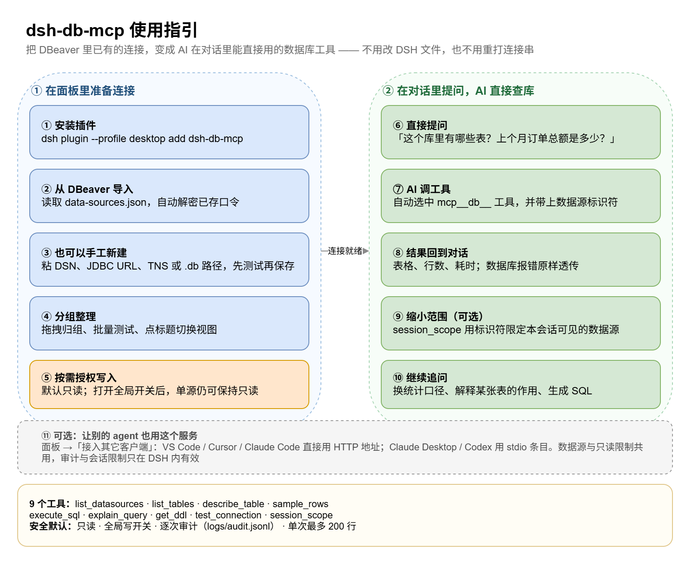
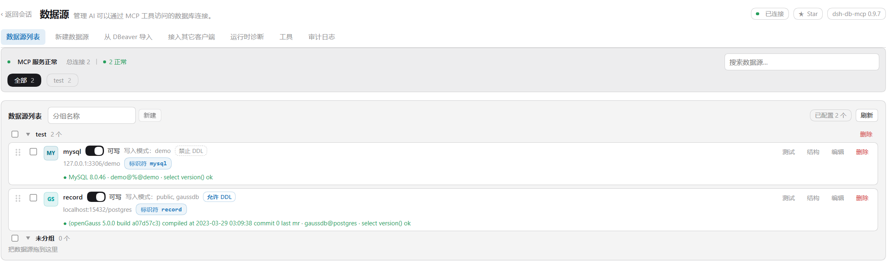

# dsh-db-mcp

[](LICENSE)
[](https://www.npmjs.com/package/dsh-db-mcp)
[](https://www.npmjs.com/package/dsh-db-mcp)
[](https://www.npmjs.com/package/dsh-db-mcp)

[English](README.md) | 中文

一个 [DSH](https://github.com/deepseek-ai/deepseek-harness) 插件，把你的数据库直接交给智能体。连接只需登记一次，之后直接提问——它在对话里调用 MCP 工具查库，再把答案带回来。

**最省事的那条路，就是你原本已经走过的那条：** 把 DBeaver 里已有的连接导进来，连保存过的口令一起，一个字都不用重打。

## 四件你不用做的事

- **不用重打连接串。** 导入器读取 DBeaver 工作区的 `data-sources.json`，再用 DBeaver 自带的密钥解密 `credentials-config.json`——主机、端口、库名、用户**和已存口令**一次到位。勾选、导入，结束。已经登记过的地址会被标出来，同一个连接不会重复添加。
- **不用配置 DSH。** bundle 只插入一行 Loader 记录；插件自己拉起 Python MCP 服务、自己注册工具——不需要 `dsh-mcp-client` 那一行，不用手改 JSON，不用导环境变量。
- **不用手工准备 Python 环境。** 不用自己建 venv、不用手跑 `pip install`：面板会找解释器、建 `.venv`、装驱动包，入口在 **运行时诊断 → 安装 / 修复依赖**。
- **不用每次从头再来。** 面板会停在上次离开的那个页签，搜索框、追踪页的输入和没填完的新数据源都还在——位置和草稿存在浏览器里，口令从不写入。

## 一张图看懂

左边是在面板里要做的事，右边是有数据源之后、在对话里发生的事。



## 界面截图

**数据源列表。** 顶部是健康概览，数据源按你的分组排列，带引擎徽标和每次工具调用要用的标识符；探测失败的那条就地把完整报错摊开，旁边一键复制。**从 DBeaver 导入** 就排在它旁边。



## 一份数据源，所有 DSH 通用

注册表放在 `~/.dsh/db-mcp/`（`datasources.json` + `secrets.json`，权限 `0600`），不属于某个 profile。所以：

- **桌面端、Web 端装哪个都行，也可以都装**——读的是同一份文件，一处导入，处处可见。
- **同时开多个 DSH 窗口也没问题。** 每个实例起自己的 Python 服务，第一个占住 HTTP 端口，后面的自动顺延到下一个空闲端口，不会因为端口冲突起不来。
- **升级、重装都不用重配。** 数据源、分组、设置、审计日志都保留，只有插件代码被替换。

## 同一个服务，也给你的其它 agent 用

面板把同一个 MCP 服务以 streamable HTTP 暴露出来。**接入其它客户端** 标签会显示地址（`http://127.0.0.1:8765/dsh-db-mcp`），并支持一键写入：

| 客户端 | 写入形式 |
| ------ | -------- |
| VS Code / VS Code Insiders | `mcp.json` 里的 HTTP 条目 |
| Cursor | `~/.cursor/mcp.json` 里的 HTTP 条目 |
| Claude Code | `~/.claude.json` 里的 HTTP 条目 |
| Claude Desktop | `claude_desktop_config.json` 里的 stdio 条目 |
| Codex CLI | `~/.codex/config.toml` 里的 `[mcp_servers.dsh-db-mcp]` |

JetBrains Air 或任何支持 MCP 的客户端，把这个地址填进去同样能用。数据源、只读标记与 DDL 开关是共享的；审计日志、工具清单与会话级限制只存在于 DSH 内。[安全](docs/safety.zh.md#哪些规则在-dsh-之外仍然生效) 一页有逐项对照表，[接入其它客户端](docs/clients.zh.md) 讲端点怎么配。

## 运行要求

| | 要求 |
| --- | --- |
| DSH | `>= 0.2.0-rc.2`（写在 `engines.dsh` 里） |
| Node.js | 用 DSH 自带的运行时（24.x）。插件只在**进程内 SQLite 探测**里用到 `node:sqlite`（需 **22.5+**）；拿不到就改用 Python 驱动，面板会如实说明 |
| Python | 自带服务需要 **3.10 及以上**（`mcp`、`psycopg`、`oracledb`、`pydantic` 都要求 3.10+；实测 3.13）。venv 由面板创建，你只需要 `PATH` 里有一个解释器，或在插件配置里指定 `pythonPath` |
| 数据库驱动 | 由面板装进那个 venv：`mcp`、`psycopg[binary]`、`py-opengauss`、`PyMySQL`、`oracledb`、`cryptography`。SQLite 不需要额外驱动 |
| 系统 | Windows / macOS / Linux。venv 路径（`.venv/Scripts/python.exe` 与 `.venv/bin/python`）和 DBeaver 工作区位置都按平台自动探测 |

## 运行

```sh
dsh plugin --profile desktop add dsh-db-mcp   # 桌面端
dsh plugin --profile web add dsh-db-mcp       # Web 端
```

`--profile` 指定装进哪个 profile（随 DSH 提供的是 `desktop` 与 `web`，其它名字首次使用时自动创建）。卸载用
`dsh plugin --profile desktop remove dsh-db-mcp`。

然后：

1. 侧栏 → **数据源**。
2. **从 DBeaver 导入** → 勾选连接 → **导入所选**。
3. 问智能体一句：*「我的 Chinook 库里有哪些表？」*

如果某条连接在 DBeaver 里没保存口令，卡片会显示**无密码**；打开该数据源补一次即可——口令只写进 `secrets.json`，不会再回到页面上。

想从零开始也行：**新建数据源**里粘一条连接串（`postgresql://user:pw@host:5432/db`、JDBC URL、Oracle TNS 描述符或 `.db` 路径），表单会自动填好；保存旁边的**测试**按钮会先真的登录一次，再让你保存。

## 智能体拿到的工具

| 工具 | 作用 |
| ---- | ---- |
| `mcp__db__list_datasources` | 已登记的数据源：id、类型、目标、是否只读 |
| `mcp__db__list_tables` | 某个源里的表与视图 |
| `mcp__db__describe_table` | 列、类型、可空、主键，外加索引、注释与行数估计 |
| `mcp__db__list_edges` | 关系图：什么连什么，每条边的状态与计数 |
| `mcp__db__propose_relation` | 记下目录里没有声明的 join |
| `mcp__db__discover_relations` | 把声明的外键导入关系图 |
| `mcp__db__mine_relations` | 从审计日志里已有的语句挖掘 join |
| `mcp__db__scan_code_relations` | 从项目的 mapper XML、`@Select` 注解与 MyBatis-Plus 片段里挖掘 join |
| `mcp__db__trace_by_key` | 查一个值落在哪里，以及它沿已确认的 join 跨表走到哪 |
| `mcp__db__list_scenes` | 一个数据源的场景：命名的表集合，追踪可以限定在里面走 |
| `mcp__db__save_scene` | 新建或更新一个场景 |
| `mcp__db__delete_scene` | 删除一个场景——关系图里的边一条都不会少 |
| `mcp__db__feedback_relation` | 追踪一步之后确认、否定或作废一条 join |
| `mcp__db__set_relation_condition` | 给一条 join 加上它成立所需的条件 |
| `mcp__db__delete_edge` | 从关系图里彻底删掉一条边 |
| `mcp__db__sample_rows` | 取几行样本 |
| `mcp__db__execute_sql` | 执行一条语句——查询，或在允许写入时执行写入 |
| `mcp__db__explain_query` | 执行计划 |
| `mcp__db__get_ddl` | `CREATE TABLE` 语句 |
| `mcp__db__test_connection` | 真实登录 + `select 1`，回报服务器/用户/schema |
| `mcp__db__session_scope` | 把本会话限制在部分数据源，或解除限制 |

`datasource` 在所有工具里都是可选的，省略时回落到标着 `isDefault` 的那条（没有就取注册表里的第一条）。查询发生在**对话里**，面板只负责管理连接，不是 SQL 控制台。**工具**标签可以把用不上的那几个关掉——少点干扰，模型上下文里的工具列表也更短。同一个标签还能选**结果里的长文本**怎么呈现：`自动` 保留超过 200 字符的单元格头尾各 50 字符，`完整` 原样返回。行数据不会丢弃，只是模型看到的文本有上限。

## 关系图

目录里记的是有人声明过的外键。真实数据库常常没声明，或者声明在登录看不到的地方——所以「什么连什么」存成一张你可以修正的图：`discover_relations` 导入声明的键，`mine_relations` 从审计日志里已有的语句挖出 join，`scan_code_relations` 读 Spring Boot 项目里已经写下的 join（mapper XML、`@Select` 注解、MyBatis-Plus 片段），`propose_relation` 手工补一条。每条边带状态，`trace_by_key` 只沿你确认过的边走，猜测不会悄悄变成事实。

**关系图**标签按数据源展示这张图：join 路径、状态角标、边的来源、被确认过几次、目标列是否有索引，以及走一步平均要多久。待确认的边可以确认、带原因否定，或加条件；已失效的边会显示上次失败的原因并给出重检入口；被拒绝的边可以重新打开。已确认与自动信任的边保留确认记录，没有黑箱。图上方的两个按钮负责把图填起来：**导入外键**读目录，**从日志挖掘**读已经审计过的语句。图下方还有一张**代价阈值**卡，用来定「一步最多花多少代价」：慢步骤的阈值、计时窗口留几次、信任需要几次样本、多大的表算大表——决定信任的规则由你调，而不是写死在源码里。

**追踪**标签收一个值，展示它走过的路：每一步的表、条件、命中行数、耗时、几格关键列样例，以及把它带过来的那条边。断链、被截断、带警告的步骤都会单独标出；每一步都可以判「对 / 多了（带原因）/ 漏了 / 无关」，判断会写回它背后的那条边。这条路按**关系图**来读：一列一个深度、从左到右，走过的每张表一个方块，走过的每条 join 画成一条线，线上注明它比较的是哪两列——形状本身就是全部视图，不再是一张图配一棵树。每一列都按上一列里父节点的位置排序，所以线不会互相穿插。点一个方块就在下方读那一步：绑定了哪些值、命中的行（被绑定列高亮）、以及那条 join 的 ✓/✗ 判断——行默认是展开的，点「收起」才折起来。已经读过的表不会再画一次——它的数据上游已经拿到了，再画一个方块只是重复；值同时出现在多处时会把那几个起点做成 chip 让你选。**场景**把一次追踪限定在一组命名的表里：走出这组表的 join 不再往下走，会到达的表单独列在场景之外，一个按钮就能把它纳进来并重跑。目标列没有索引、表又很大的 join 不会直接执行：这一步会回来问要不要整表扫描，点「仍然执行」会带 `confirm_slow` 重跑。这两页都不接受 SQL——语句由服务端按关系图拼装并参数绑定。

## 安全

- **默认只读**，三道互相独立的闸门：数据源列表标题行上的全局写开关 + 单源标记 + 单独的 DDL 开关，全部打开才允许写入。
- **可写的数据源可以写登录能看到的每一个模式。** 边界就是数据库本身：一个登录被授予了哪个模式，就能写哪个模式。读取不受限制。拦截发生在 Python 服务里，面板、智能体和 HTTP 接口一视同仁。
- **DDL 需要显式开启。** `create`、`alter`、`drop`、`truncate`、`rename`、`grant`、`revoke` 在数据源的 DDL 开关打开之前一律拒绝；`insert`、`update`、`delete` 不受影响。
- **口令不出本机，且加密落盘。** `secrets.json` 里每个数据源存的是 AES-256-GCM 信封，密钥在旁边的 `secret.key`（`0600`）；任何 HTTP 接口都不返回它，Python 子进程拿到的也只是很短的环境变量白名单，而不是整个 DSH 环境。
- **每次工具调用都有审计**，写入 `logs/audit.jsonl`——工具、数据源、耗时、行数、SQL；结果行永不记录。
- **面板不会执行 SQL。** 结构浏览只转发 `list_tables` 与 `describe_table`。

## 文档

| 文档 | 内容 |
| ---- | ---- |
| [CHANGELOG.md](CHANGELOG.md) | 每个版本改了什么 —— 一版一段、带日期，外加 `main` 上还没来得及发布的部分 |
| [docs/guide.zh.md](docs/guide.zh.md) | 面板操作：安装、连接串、导入、分组、结构浏览（中文） |
| [docs/safety.zh.md](docs/safety.zh.md) | 三道闸门、DDL 开关，以及外部客户端仍受哪些约束（中文） |
| [docs/clients.zh.md](docs/clients.zh.md) | HTTP 端点、接入其它客户端、工具清单（中文） |
| [docs/runtime.zh.md](docs/runtime.zh.md) | 运行时目录、Python 依赖、Docker 测试库、排错（中文） |
| [docs/reference.md](docs/reference.md) | HTTP 接口、工具契约、注册表与设置文件、插件配置（英文） |
| [docs/development.md](docs/development.md) | 目录结构、热重载、测试套件、发布流程（英文） |
| [docs/design-notes.md](docs/design-notes.md) | 设计说明（中文）：架构、数据模型、三道闸门与插件配置的现状规格，以及每个决定的理由 |
| [docs/architecture.drawio](docs/architecture.drawio) | 三页图：文件结构、代码调用、运行时架构 |

## 许可

Apache License 2.0 —— 见 [LICENSE](LICENSE)。
