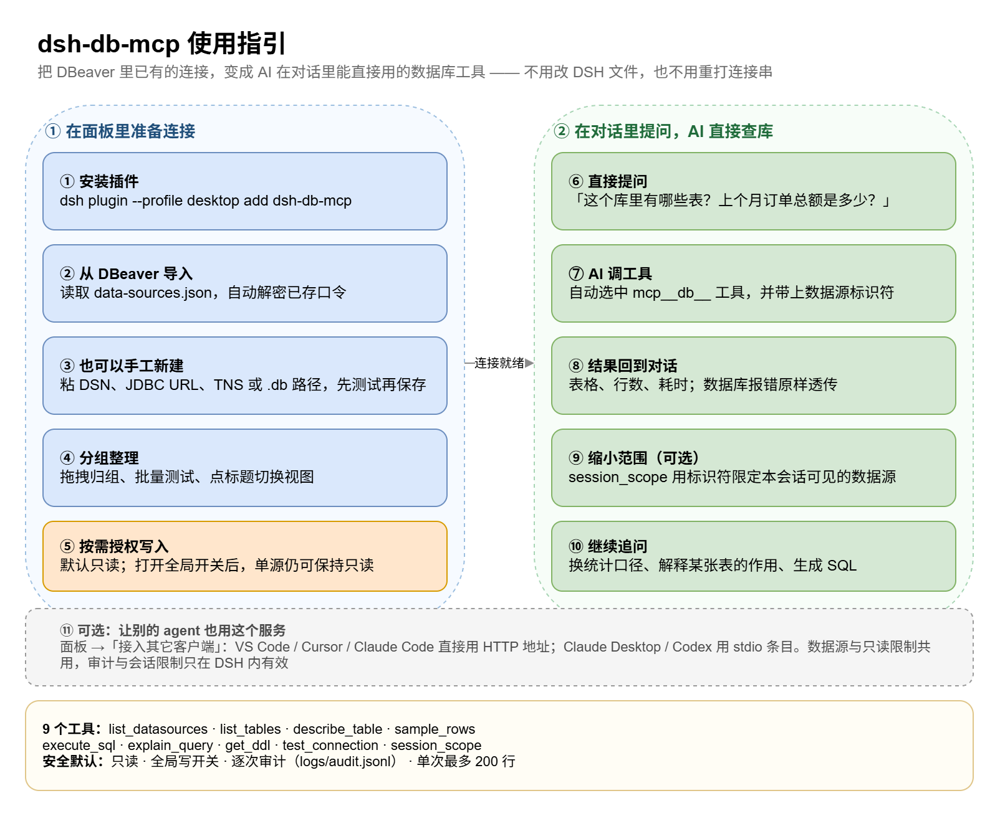
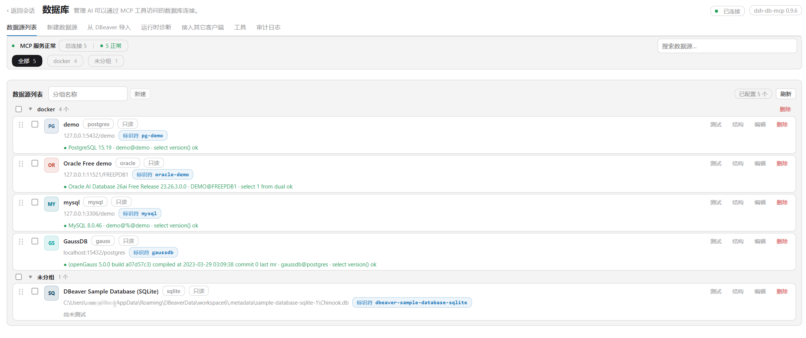

# dsh-db-mcp

[](LICENSE)
[](https://www.npmjs.com/package/dsh-db-mcp)
[](https://www.npmjs.com/package/dsh-db-mcp)
[](https://www.npmjs.com/package/dsh-db-mcp)

[English](README.md) | 中文

一个 [DSH](https://github.com/deepseek-ai/deepseek-harness) 插件，把你的数据库直接交给智能体。连接只需登记一次，之后直接提问——它在对话里调用 MCP 工具查库，再把答案带回来。

**最省事的那条路，就是你原本已经走过的那条：** 把 DBeaver 里已有的连接导进来，连保存过的口令一起，一个字都不用重打。

## 三件你不用做的事

- **不用重打连接串。** 导入器读取 DBeaver 工作区的 `data-sources.json`，再用 DBeaver 自带的密钥解密 `credentials-config.json`——主机、端口、库名、用户**和已存口令**一次到位。勾选、导入，结束。已经登记过的地址会被标出来，同一个连接不会重复添加。
- **不用配置 DSH。** bundle 只插入一行 Loader 记录；插件自己拉起 Python MCP 服务、自己注册工具——不需要 `dsh-mcp-client` 那一行，不用手改 JSON，不用导环境变量。
- **不用手工准备 Python 环境。** 不用自己建 venv、不用手跑 `pip install`：面板会找解释器、建 `.venv`、装驱动包，入口在 **运行时诊断 → 安装 / 修复依赖**。

## 一张图看懂

左边是在面板里要做的事，右边是有数据源之后、在对话里发生的事。



## 界面截图

**数据源列表。** 顶部是健康概览，数据源按你的分组排列，带引擎徽标和每次工具调用要用的标识符；探测失败的那条就地把完整报错摊开，旁边一键复制。**从 DBeaver 导入** 就排在它旁边。



## 一份数据源，所有 DSH 通用

注册表放在 `~/.dsh/db-mcp/`（`datasources.json` + `secrets.json`，权限 `0600`），不属于某个 profile。所以：

- **桌面端、Web 端装哪个都行，也可以都装**——读的是同一份文件，一处导入，处处可见。
- **同时开多个 DSH 窗口也没问题。** 每个实例起自己的 Python 服务，第一个占住 HTTP 端口，后面的自动顺延到下一个空闲端口，不会因为端口冲突起不来。
- **升级、重装都不用重配。** 数据源、分组、设置、审计日志都保留，只有插件代码被替换。

## 同一个服务，也给你的其它 agent 用

面板把同一个 MCP 服务以 streamable HTTP 暴露出来。**接入其它客户端** 标签会显示地址（`http://127.0.0.1:8765/dsh-db-mcp`），并支持一键写入：

| 客户端 | 写入形式 |
| ------ | -------- |
| VS Code / VS Code Insiders | `mcp.json` 里的 HTTP 条目 |
| Cursor | `~/.cursor/mcp.json` 里的 HTTP 条目 |
| Claude Code | `~/.claude.json` 里的 HTTP 条目 |
| Claude Desktop | `claude_desktop_config.json` 里的 stdio 条目 |
| Codex CLI | `~/.codex/config.toml` 里的 `[mcp_servers.dsh-db-mcp]` |

JetBrains AI 或任何支持 MCP 的客户端，把这个地址填进去同样能用。数据源与只读规则是共享的；审计日志与会话级限制只存在于 DSH 内。详见[使用指南](docs/guide.zh.md#接入其它客户端)。

## 运行要求

| | 要求 |
| --- | --- |
| DSH | `>= 0.2.0-rc.2`（写在 `engines.dsh` 里） |
| Node.js | 用 DSH 自带的运行时（24.x）。插件只在**进程内 SQLite 探测**里用到 `node:sqlite`（需 **22.5+**）；拿不到就改用 Python 驱动，面板会如实说明 |
| Python | 自带服务需要 **3.10 及以上**（`mcp`、`psycopg`、`oracledb`、`pydantic` 都要求 3.10+；实测 3.13）。venv 由面板创建，你只需要 `PATH` 里有一个解释器，或在插件配置里指定 `pythonPath` |
| 数据库驱动 | 由面板装进那个 venv：`mcp`、`psycopg[binary]`、`py-opengauss`、`PyMySQL`、`oracledb`。SQLite 不需要额外驱动 |
| 系统 | Windows / macOS / Linux。venv 路径（`.venv/Scripts/python.exe` 与 `.venv/bin/python`）和 DBeaver 工作区位置都按平台自动探测 |

## 运行

```sh
dsh plugin --profile desktop add dsh-db-mcp   # 桌面端
dsh plugin --profile web add dsh-db-mcp       # Web 端
```

`--profile` 指定装进哪个 profile（随 DSH 提供的是 `desktop` 与 `web`，其它名字首次使用时自动创建）。卸载用
`dsh plugin --profile desktop remove dsh-db-mcp`。

然后：

1. 侧栏 → **数据库**。
2. **从 DBeaver 导入** → 勾选连接 → **导入所选**。
3. 问智能体一句：*「我的 Chinook 库里有哪些表？」*

如果某条连接在 DBeaver 里没保存口令，卡片会显示**无密码**；打开该数据源补一次即可——口令只写进 `secrets.json`，不会再回到页面上。

想从零开始也行：**新建数据源**里粘一条连接串（`postgresql://user:pw@host:5432/db`、JDBC URL、Oracle TNS 描述符或 `.db` 路径），表单会自动填好；保存旁边的**测试**按钮会先真的登录一次，再让你保存。

## 智能体拿到的工具

| 工具 | 作用 |
| ---- | ---- |
| `mcp__db__list_datasources` | 已登记的数据源：id、类型、目标、是否只读 |
| `mcp__db__list_tables` | 某个源里的表与视图 |
| `mcp__db__describe_table` | 列、类型、可空、主键 |
| `mcp__db__sample_rows` | 取几行样本 |
| `mcp__db__execute_sql` | 执行一条语句——查询，或在允许写入时执行写入 |
| `mcp__db__explain_query` | 执行计划 |
| `mcp__db__get_ddl` | `CREATE TABLE` 语句 |
| `mcp__db__test_connection` | 真实登录 + `select 1`，回报服务器/用户/schema |
| `mcp__db__session_scope` | 把本会话限制在部分数据源，或解除限制 |

`datasource` 在所有工具里都是可选的，省略时回落到标着 `isDefault` 的那条（没有就取注册表里的第一条）。查询发生在**对话里**，面板只负责管理连接，不是 SQL 控制台。**工具**标签可以把用不上的那几个关掉——少点干扰，模型上下文里的工具列表也更短。

## 安全

- **默认只读**，两道互相独立的闸门：全局写开关 + 单源标记，两者都打开才允许写入。
- **口令不出本机。** 存在 `secrets.json`（`0600`）；任何 HTTP 接口都不返回它，Python 子进程拿到的也只是很短的环境变量白名单，而不是整个 DSH 环境。
- **每次工具调用都有审计**，写入 `logs/audit.jsonl`——工具、数据源、耗时、行数、SQL；结果行永不记录。
- **面板不会执行 SQL。** 结构浏览只转发 `list_tables` 与 `describe_table`。

## 文档

| 文档 | 内容 |
| ---- | ---- |
| [docs/guide.zh.md](docs/guide.zh.md) | 面板操作、连接串、分组、Docker 测试库、排错（中文） |
| [docs/reference.md](docs/reference.md) | HTTP 接口、工具契约、注册表与设置文件、插件配置（英文） |
| [docs/development.md](docs/development.md) | 目录结构、热重载、测试套件、发布流程（英文） |
| [docs/design-notes.md](docs/design-notes.md) | 设计日志（P1 → P7）与决策记录（英文） |
| [docs/architecture.drawio](docs/architecture.drawio) | 三页图：文件结构、代码调用、运行时架构 |

## 许可

Apache License 2.0 —— 见 [LICENSE](LICENSE)。
