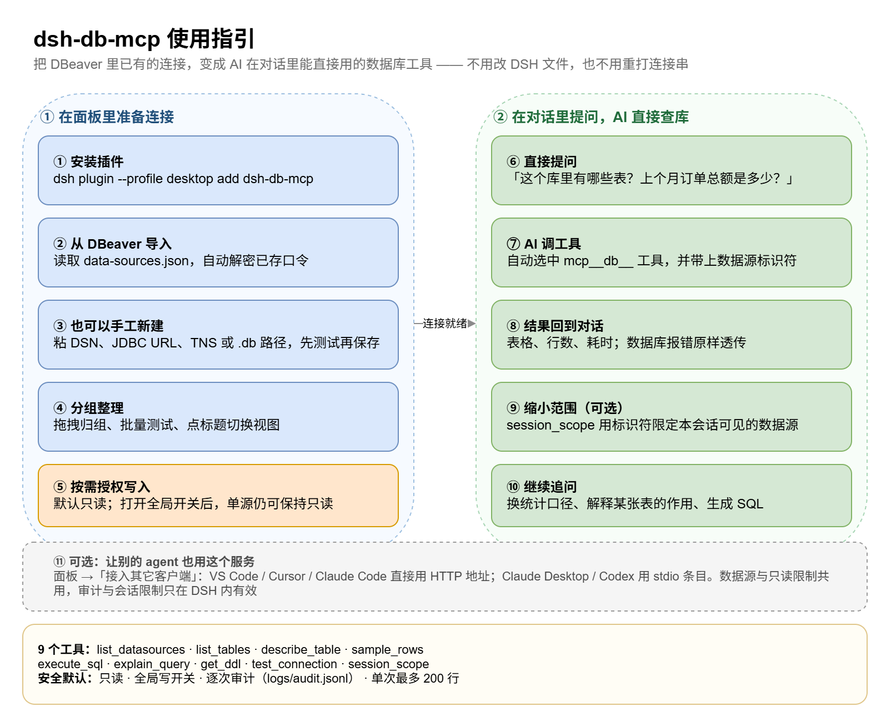

# 从 DBeaver 一键导入数据源，让 AI 也用起来

你的 Agent 会写 SQL，但它不认识你的数据库。每次对话你都得把表结构贴进聊天框，贴上几行样例数据，再解释字段关系。等这些都做完，真正的问题才开始被回答。

[`dsh-db-mcp`](https://github.com/halcyon6669/dsh-db-mcp) 解决的就是这件事。它是一个 [DeepSeek Harness](https://github.com/deepseek-ai/deepseek-harness)（DSH）插件，把你的数据库连接交给 Agent 直接查询，一次配置，长期可用。



上面这张图是插件的实际界面：一边管理数据源和写权限开关，一边让 Agent 通过 MCP 工具直接查库。

## 功能一览

- **DBeaver 一键导入。** 读取你已有的 DBeaver 工作区（`data-sources.json`），用 DBeaver 自己的密钥解密保存的密码（`credentials-config.json`），勾选连接即导入，重复的数据源自动跳过。主机、端口、库名、密码都不用重新填。
- **其它 Agent 一键配置。** 底层是标准 MCP 服务，DSH 只是客户端之一。面板的 **Connect** 标签页点一下，就把配置写进 VS Code、Cursor、Claude Code、Claude Desktop、Codex CLI。JetBrains AI 或任何支持 MCP 的工具，把端点指向 `http://127.0.0.1:8765/dsh-db-mcp` 即可连上。
- **可写，但默认只读。** `execute_sql` 支持 `insert`、`update`、`delete`，能改脏数据、补记录、清临时表。每个数据源默认只读，要写才手动打开。
- **三道写权限闸门。** 全局写开关、单源只读标记、DDL 开关，三层默认全部关闭，必须都打开才允许写入。DDL 独立控制 `create`、`alter`、`drop`、`truncate` 等结构变更。闸门在 Python 服务端强制执行，面板和任何外部客户端都绕不过去。
- **全程留痕。** 每次工具调用写进 `logs/audit.jsonl`，记下调用方（`dsh-agent`、`panel` 或外部客户端）、SQL 原文、耗时、返回行数。刻意不记录结果行，避免日志变成新的数据泄漏面。
- **十个数据库工具。** 列数据源、列表和视图、描述表结构、一次列出全部外键、样例行、执行 SQL、查询计划、建表语句、连接探测、对话内数据源限定。多表 join 只需要一次 `list_relations`，不用逐表描述。
- **一套数据源到处用。** 注册表放在 `~/.dsh/db-mcp/`，桌面端和 Web 端读同一个文件，导入一次到处可见。升级或重装只替换插件代码，数据源和设置都保留。
- **免手工配置环境。** 安装自动拉起 Python MCP 服务、建隔离的 `.venv`、装好数据库驱动，不用改 JSON、不用建虚拟环境、不用手动 `pip install`。缺依赖时 Runtime 标签页指出来，点一下就修好。

## 三步上手

```sh
dsh plugin --profile desktop add dsh-db-mcp   # 桌面应用
dsh plugin --profile web add dsh-db-mcp       # Web UI
```

1. 侧边栏 → **Data sources**。
2. **Import from DBeaver** → 勾选连接 → **Import selected**。
3. 问 Agent：「我的 Chinook 数据库里有哪些表？」

不用 DBeaver 也能加：**New data source** 接受连接字符串（`postgresql://user:pw@host:5432/db`、JDBC URL、Oracle TNS 描述符或 `.db` 文件路径）并自动填表，保存前 **Test** 按钮会真实登录探测一次。

需要 Agent 动手改数据时，再打开两道开关：标题栏的全局写开关，加上那个数据源的只读开关。要改表结构，才需要第三个 DDL 开关。

支持 SQLite、PostgreSQL、openGauss、MySQL 和 Oracle，跨平台 Windows、macOS、Linux。

## 两个边界，说清楚

写权限的边界是数据库账号本身。一个可写数据源，能写该账号可见的所有 schema。插件不假装自己是权限系统，真正的隔离要靠数据库账号来做，README 里也明确写了这一点。

端点只绑定回环地址且没有鉴权，信任边界是「任何以你本机用户身份运行的进程」。不用写入时把全局写开关保持关闭，没有外部客户端连接时把端点停掉。

## 其他细节

- **密码加密落盘。** `secrets.json` 为每个数据源存 AES-256-GCM 加密信封，密钥放在 `secret.key`（权限 `0600`）。没有 HTTP 路由返回密码，单独复制配置文件也带不走可用凭据。
- **硬限制防爆。** 30 秒语句超时（可配置）、2000 行结果上限、长文本单元格头尾摘要，防止一堵文字墙吃掉模型上下文。
- **面板不跑查询。** 面板只做连接和开关管理，结构浏览器只转发 `list_tables` 和 `describe_table`。所有查询都发生在对话里，那才是模型能对结果进行推理的地方。

## 链接

- GitHub：[halcyon6669/dsh-db-mcp](https://github.com/halcyon6669/dsh-db-mcp)
- npm：[dsh-db-mcp](https://www.npmjs.com/package/dsh-db-mcp)
- 许可证：Apache 2.0

如果这篇帮你省下了一次复制粘贴，欢迎点赞，或在 GitHub 上点个 Star。
