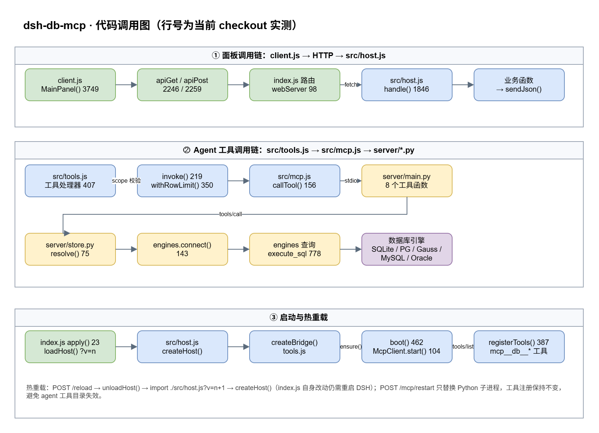
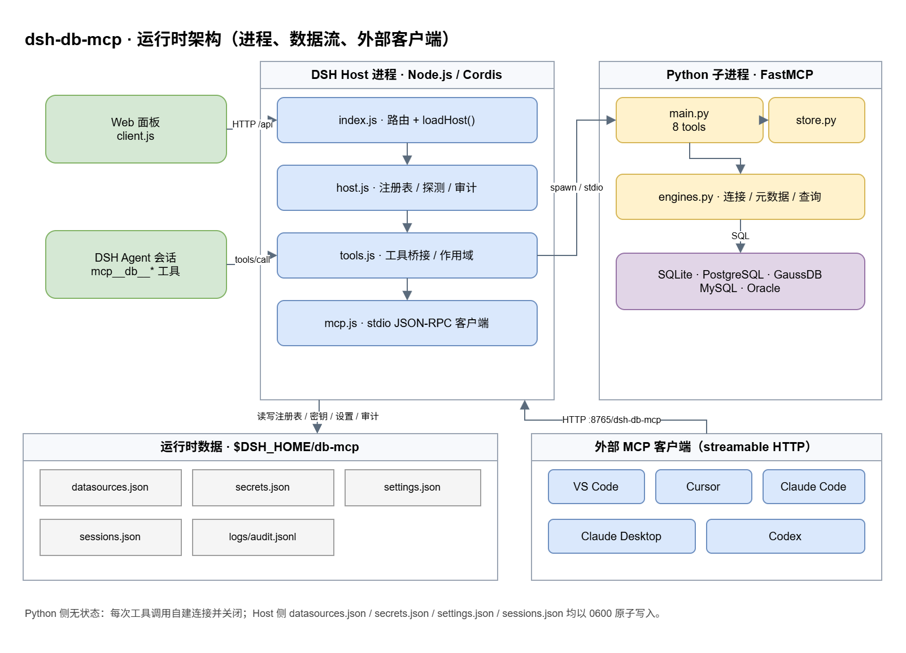

# Development

How the repository is put together, how to iterate on it without restarting DSH
every time, and how a release happens.

## Layout

```
index.js            Cordis entry: routes only, plus the cache-busting import of src/host.js
src/host.js         Host half: registry, DBeaver import, probes, settings, audit, MCP bridge wiring
src/mcp.js          minimal MCP client over stdio (newline-delimited JSON-RPC)
src/secretbox.js    AES-256-GCM envelopes for secrets.json, plus the secret.key file
src/tools.js        spawns the Python server, publishes its tools on the host tools service
client.js           browser half, generated from client.parts/ — do not edit directly
client.parts/       source of client.js: header, DICT, CSS, then the components
dev/build-client.mjs concatenates the parts back into client.js (and checks freshness)
locale/{en,zh}.json package metadata (title/description) shown by the plugin card
server/main.py      FastMCP server: twenty tools
server/engines.py   per-engine connect / introspect / query / DDL
server/writes.py    write guard: refuses DDL unless the source's allowDdl switch is on
server/secretbox.py opens the envelopes written by src/secretbox.js
server/store.py     reads the registry written by the Host
cordis.patch.yml    one Loader row with id "db-mcp"
dev/                test suites and the version bump script
dev/fixtures/       small JSON payloads a browser pass renders (checked, so it can be repeated)
docs/               this documentation
asset/              screenshots and diagram exports used by the READMEs
```

The package ships `index.js`, `src/*.js`, `client.js`, `locale/*.json`, `icon.svg`,
`cordis.patch.yml`, `server/*.py`, `server/requirements.txt`, `docs/*.md`, both
READMEs and the license. `client.parts/` and `dev/` stay out of the tarball: the browser
loads the generated `client.js` alone (DSH cannot resolve sibling relative requires),
so edit a part, run `node dev/build-client.mjs`, and commit both the part and the
regenerated file. `asset/` and `docs/*.drawio` stay out of the npm tarball on
purpose: they are read from the repository (the READMEs link them over `raw.githubusercontent.com`).

## Architecture diagrams

`docs/architecture.drawio` holds three pages 鈥?the file layout, the call graph and the
runtime picture. The call graph and the runtime page are also exported to
`asset/architecture-calls.png` and `asset/architecture-runtime.png` for places that
cannot render draw.io. Line numbers inside the diagrams are the ones measured in this
checkout, so refresh them when a release moves those functions: open the file, edit the
labels, re-export the PNGs.





## Hot reload

The Cordis Loader imports a plugin entry **once per process**, so editing
`index.js` needs a DSH restart. Everything else is deliberately reloadable:

- `index.js` only registers two routes and imports `./src/host.js?v=<n>`, so
  `POST /plugins/db-mcp/api/reload` re-imports the whole Host half.
- `src/host.js` and `src/tools.js` propagate the same generation string to their own
  imports (`new URL(import.meta.url).searchParams.get('v')`), otherwise Node's module
  cache would keep returning the old copies of the inner files.
- The Python server is a child process: `POST /mcp/restart` (or the **Restart MCP**
  button) replaces it. Tool registrations stay in place 鈥?disposing and re-registering
  them makes the agent's tool catalog go stale and report `unknown tool`.

A profile that links this directory (`dsh plugin --profile desktop add <path>`)
reflects edits immediately; one installed from npm needs a release.

## Tests

```sh
npm test              # everything below
npm run test:ci       # the portable subset the publish workflow runs
node dev/build-client.mjs        # rebuild client.js from client.parts/
node dev/build-client.mjs --check # fail if the committed client.js is stale
npm run test:mcp      # real Python server, real SQLite; Oracle when its container is up
npm run test:engines  # the Python suites: engines.py, writes.py and secretbox.py
npm run test:docs     # fenced blocks, table widths and relative links in the docs
npm run test:changelog # the changelog's structure and its per-version sections
```

| Suite | Covers |
| ----- | ------ |
| `dev/build-client.mjs --check` | `client.js` matches the concatenation of `client.parts/*.js` (run first in both `npm test` and `test:ci`) |
| `dev/engines.test.mjs` + `engines.test.py` | commit/rollback and `affectedRows` contract of `execute_sql`, the openGauss plumbing (host list, IRI escaping, the `ssl.wrap_socket` shim), the pre-12c Oracle catalogue fallback and the `infra_error` paths, no database needed |
| `dev/writes.test.py` | the write guard: statement splitting, the DDL opt-in switch, reads and row writes always passing |
| `dev/secretbox.test.py` | the envelope reader: key file, round trips, aad mismatch, plaintext fallback |
| `dev/selftest.mjs` | mounts `src/host.js` on a throwaway port: registry, validation, groups, bulk, schema route, DBeaver scan against a DBeaver home the suite writes itself, probes |
| `dev/infra.test.mjs` | the test infrastructure itself: a `--dir=` run of `selftest.mjs` writes to that path rather than to a folder named after the flag, and leaves no such folder behind |
| `dev/shims.test.mjs` | mounts `index.js`, checks both routes, `/reload`, tool publication, and that `package.json` has no BOM |
| `dev/parse.test.mjs` | the connection-string parser (DSN, JDBC, TNS, SID, paths) |
| `dev/render.test.mjs` | components rendered with a stub React: tab bar, form fields, list, bulk bar, breadcrumbs |
| `dev/i18n.test.mjs` | en/zh key parity, no dead keys, no stray copy outside the dictionaries |
| `dev/p5.test.mjs` | settings, audit rotation, Python environment discovery |
| `dev/mcp.test.mjs` | real stdio handshake, every published tool, read-only refusal, login failures |
| `dev/docs.check.mjs` | balanced code fences, table column counts, relative links and headings in every Markdown file |
| `dev/changelog.mjs` | the changelog's structure: one dated section per released version, newest first, each with a link target |

Suites that need external services skip rather than fail: `mcp.test.mjs` probes the
Oracle port and reports a skip when the container is down, and it skips its query checks
when no SQLite source is registered on this machine, so a green `npm test` never depends
on what happens to be configured here. The DBeaver check in `selftest.mjs` works the same
way: the suite writes its own DBeaver home instead of reading the editor's.

Both of those traps now have a regression test, because a fix nobody tests is a fix that
comes undone. `dev/infra.test.mjs` runs `selftest.mjs` with `--dir=<path>` into a scratch
directory and asserts the directory exists afterwards (and that no folder named `--dir=…`
was created beside the checkout) — that is the path-handling half. `dev/sources.test.py`
class `CarriageReturns` writes the same mapper and Java fixtures with CRLF line endings
and asserts the scanner finds identical joins and the same line numbers — that is the
`\r` half. Note what the CRLF test does and does not claim: the scanner normalises
whitespace rather than anchoring on line ends, so it is CRLF-insensitive by construction
today, and the test locks that property in rather than repairing a live bug.

### A manual smoke run for the catalog refresh

`dev/manual/catalog-smoke.py` is not part of `npm test` — it needs a database with
hundreds of tables. It drives the real `bundle_cli.refresh` against a Docker engine,
creates (or discovers, with `--no-create`) 520 tables, and prints total time, the
per-table p50 / p95 / max and how many tables timed out. Use it before touching a
timeout default:

```
python dev/manual/catalog-smoke.py --kind postgres --port 15433 --user postgres \
    --password testpass --database postgres --tables 520
```

It suggests a per-table timeout and a total budget in its output, and deliberately
changes nothing: the numbers are an argument for a default, not the default itself.

`p5.test.mjs` starts the real HTTP endpoint and therefore starts a real
`python main.py --http` child. It asks the OS for a free port instead of taking the
configured one, and it stops the endpoint in a `finally` block before disposing the host,
so a failing check still ends the child. Both halves matter: a child left behind by an
earlier run keeps the port, the next `POST /http/start` answers 500, and the failure looks
like a code bug rather than a leftover process.

## Where the tests run

`publish.yml` runs on `ubuntu-latest` with Node 24 and Python 3.12. The machine this was
developed on is Windows, and the local numbers in the log come from Node v22.19.0 and the
plugin's own venv (Python 3.13.7) — a green local run is evidence, not proof, for CI: the
one place the difference has bitten before is path handling in `dev/selftest.mjs` and the
`\r` tolerance in line-anchored regexes.

## Releasing

Release notes live in [`CHANGELOG.md`](../CHANGELOG.md), in the
[Keep a Changelog](https://keepachangelog.com/en/1.1.0/) shape: one `## [version]`
section per release, newest first, with `### Added` / `### Changed` / `### Fixed` /
`### Removed` underneath. Work that is merged but not published accumulates under
`## [Unreleased]`; there is exactly one such heading, always at the top.

Writing the change down is part of the change. A pull request that alters behaviour
adds its line to the matching subsection of `[Unreleased]`; a pure refactor or a test
only change earns nothing. The entry says what a user can now do or no longer hits,
not which function moved.

The package publishes from GitHub Actions with
[npm trusted publishing](https://docs.npmjs.com/trusted-publishers):
`.github/workflows/publish.yml` trades the workflow's OIDC token for a short-lived
publish credential, so no `NPM_TOKEN` secret exists.

```sh
node dev/bump.mjs 0.9.8     # package.json + src/host.js + the changelog section
git commit -am "chore: release 0.9.8"
git push origin main
git tag v0.9.8 && git push origin v0.9.8
```

`bump.mjs` is the only supported way to cut a version: it bumps both files that carry
one and turns `## [Unreleased]` into `## [0.9.8] - <today>`, opening a fresh
`[Unreleased]` above it and rewriting the two compare links at the bottom. It refuses
to run when the section is empty, so a version cannot ship with nothing to say.

The workflow then refuses to publish when the tag, `package.json` and the changelog
disagree 鈥?it runs `node dev/changelog.mjs check`, extracts the section for the tag
with `node dev/changelog.mjs notes <version>`, runs `npm run test:ci`, publishes with
`--provenance`, and polls the registry until the version appears. Local `npm publish`
still works for the very first release, before a trusted publisher exists.

Pushing the tag publishes to npm and nothing else: it does **not** open a page under
*Releases*, so the release page is created from the same section:

```sh
node dev/changelog.mjs notes 0.9.8 > /tmp/notes.md
gh release create v0.9.8 \
  --title "v0.9.8 - <one line summary>" \
  --notes-file /tmp/notes.md \
  --verify-tag
```

`--verify-tag` makes the command fail instead of creating a tag that was never pushed.
The changelog file is the single source: the release body is a copy of one section of
it, so correcting that section afterwards means editing the release page too. Releases
older than 0.6.4 predate the changelog; their notes are in the annotated tag object,
which `git tag -l --format='%(contents)' v0.5.0` prints, and
[design-notes.md](design-notes.md) narrates them.

Keep `src/host.js`'s `PLUGIN_VERSION` in step with `package.json` 鈥?the panel and
`/health` read it, and a mismatch ships a package that reports the previous version.
That is what `bump.mjs` is for.

Installing that release into a profile (the profile name is required, the verb is
pnpm's):

```sh
dsh plugin --profile desktop add dsh-db-mcp@0.9.8
dsh plugin --profile desktop remove dsh-db-mcp
```

Expect pnpm to print `Added 1 entry to minimumReleaseAgeExclude 鈥 when the version
is younger than its 1440-minute cooldown: that line is pnpm recording a per-version
exception so the explicit pin may install. See
[guide.md](guide.md#install-and-upgrade) for the policy knobs.

## When git says "not a git repository"

Three times on this machine `git status` answered `fatal: not a git repository` while
`.git/objects` still held every commit: `HEAD`, `config` and `index` had vanished,
and git refuses to run at all without `HEAD` (even with an explicit `--git-dir`).
The history was never lost, so it can be rebuilt from the refs:

```sh
node dev/git-repair.mjs --check   # report what is missing
node dev/git-repair.mjs           # write HEAD + config, then git reset to rebuild the index
```

The remote URL comes from `package.json`'s `repository`, and the branch is the one
with the newest ref, so the script stays machine independent. It is a repair, not a
backup: if `.git/objects` itself is missing, restore from a bundle instead
(`git bundle create backup.bundle --all` in a healthy checkout, then `git clone`).

## Adding an engine

1. `server/engines.py`: extend `connect()` and the dialect tables (`_quote`,
   `_limit_clause`, `list_tables`, `describe_table`, `table_ddl`).
2. `src/host.js`: add the kind to `KINDS`, give it a default port, a validation
   branch in `normalizeInput`, and a `describeTarget` label.
3. `client.parts/header.js`: add the string to `KINDS` and, if the form needs extra
   fields, to `SourceForm` in `client.parts/app.js`; extend `parseConnectionText` with
   the scheme and JDBC prefix. Then `node dev/build-client.mjs` to regenerate `client.js`.
4. `server/requirements.txt`: the driver, and `docs/reference.md`: the field table.
5. Tests: `dev/parse.test.mjs` for the string, `dev/selftest.mjs` for validation and
   the probe, and a demo container in `docs/runtime.md`.
