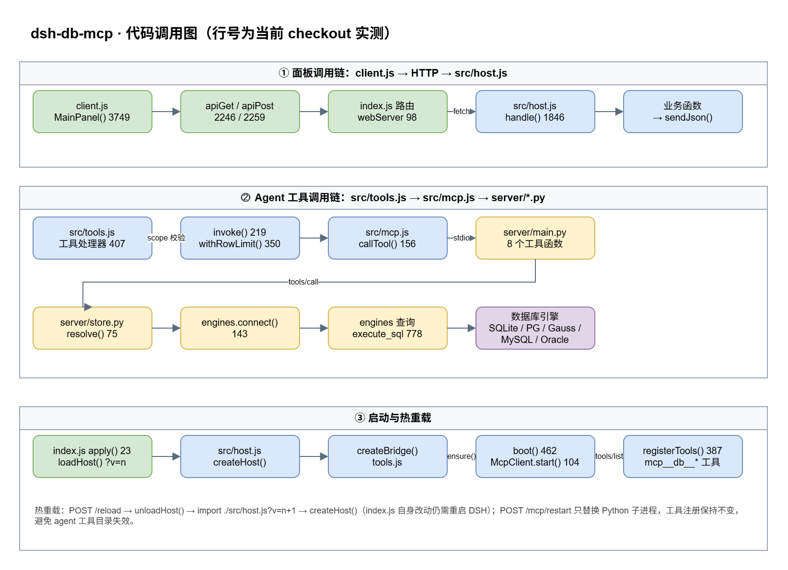
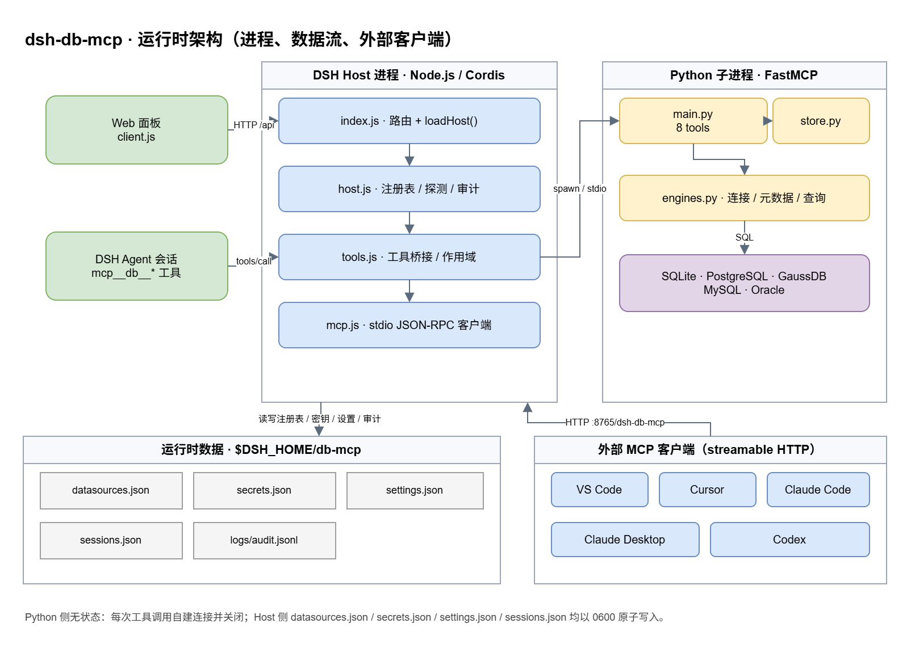

# Development

How the repository is put together, how to iterate on it without restarting DSH
every time, and how a release happens.

## Layout

```
index.js            Cordis entry: routes only, plus the cache-busting import of src/host.js
src/host.js         Host half: registry, DBeaver import, probes, settings, audit, MCP bridge wiring
src/mcp.js          minimal MCP client over stdio (newline-delimited JSON-RPC)
src/secretbox.js    AES-256-GCM envelopes for secrets.json, plus the secret.key file
src/tools.js        spawns the Python server, publishes its tools on the host tools service
client.js           browser half: sidebar entry + panel (React, theme tokens only)
locale/{en,zh}.json package metadata (title/description) shown by the plugin card
server/main.py      FastMCP server: eight tools
server/engines.py   per-engine connect / introspect / query / DDL
server/writes.py    write guard: parses each statement's target schema against writableSchemas
server/secretbox.py opens the envelopes written by src/secretbox.js
server/store.py     reads the registry written by the Host
cordis.patch.yml    one Loader row with id "db-mcp"
dev/                test suites and the version bump script
docs/               this documentation
asset/              screenshots and diagram exports used by the READMEs
```

The package ships `index.js`, `src/*.js`, `client.js`, `locale/*.json`, `icon.svg`,
`cordis.patch.yml`, `server/*.py`, `server/requirements.txt`, `docs/*.md`, both
READMEs and the license. `asset/` and `docs/*.drawio` stay out of the npm tarball on
purpose: they are read from the repository (the READMEs link them over `raw.githubusercontent.com`).

## Architecture diagrams

`docs/architecture.drawio` holds three pages — the file layout, the call graph and the
runtime picture. The call graph and the runtime page are also exported to
`asset/architecture-calls.png` and `asset/architecture-runtime.png` for places that
cannot render draw.io. Line numbers inside the diagrams are the ones measured in this
checkout, so refresh them when a release moves those functions: open the file, edit the
labels, re-export the PNGs.





## Hot reload

The Cordis Loader imports a plugin entry **once per process**, so editing
`index.js` needs a DSH restart. Everything else is deliberately reloadable:

- `index.js` only registers two routes and imports `./src/host.js?v=<n>`, so
  `POST /plugins/db-mcp/api/reload` re-imports the whole Host half.
- `src/host.js` and `src/tools.js` propagate the same generation string to their own
  imports (`new URL(import.meta.url).searchParams.get('v')`), otherwise Node's module
  cache would keep returning the old copies of the inner files.
- The Python server is a child process: `POST /mcp/restart` (or the **Restart MCP**
  button) replaces it. Tool registrations stay in place — disposing and re-registering
  them makes the agent's tool catalog go stale and report `unknown tool`.

A profile that links this directory (`dsh plugin --profile desktop add <path>`)
reflects edits immediately; one installed from npm needs a release.

## Tests

```sh
npm test              # everything below except mcp.test.mjs
npm run test:ci       # the portable subset the publish workflow runs
npm run test:mcp      # real Python server, real SQLite; Oracle when its container is up
npm run test:engines  # the Python suites: engines.py, writes.py and secretbox.py
npm run test:docs     # fenced blocks, table widths and relative links in the docs
```

| Suite | Covers |
| ----- | ------ |
| `dev/engines.test.mjs` + `engines.test.py` | commit/rollback and `affectedRows` contract of `execute_sql`, no database needed |
| `dev/writes.test.py` | the write guard: statement splitting, target extraction, default schema per engine, the writableSchemas check |
| `dev/secretbox.test.py` | the envelope reader: key file, round trips, aad mismatch, plaintext fallback |
| `dev/gauss.check.py` | openGauss plumbing offline: comma host list, IRI escaping, the `ssl.wrap_socket` shim, no network |
| `dev/selftest.mjs` | mounts `src/host.js` on a throwaway port: registry, validation, groups, bulk, schema route, DBeaver scan, probes |
| `dev/shims.test.mjs` | mounts `index.js`, checks both routes, `/reload`, tool publication, and that `package.json` has no BOM |
| `dev/parse.test.mjs` | the connection-string parser (DSN, JDBC, TNS, SID, paths) |
| `dev/render.test.mjs` | components rendered with a stub React: tab bar, form fields, list, bulk bar, breadcrumbs |
| `dev/i18n.test.mjs` | en/zh key parity, no dead keys, no stray copy outside the dictionaries |
| `dev/p5.test.mjs` | settings, audit rotation, Python environment discovery |
| `dev/mcp.test.mjs` | real stdio handshake, all eight tools, read-only refusal, login failures |
| `dev/docs.check.mjs` | balanced code fences, table column counts, relative links and headings in every Markdown file |

Suites that need external services skip rather than fail: `mcp.test.mjs` probes the
Oracle port and prints `skip … is not listening` when the container is down.

## Releasing

The package publishes from GitHub Actions with
[npm trusted publishing](https://docs.npmjs.com/trusted-publishers):
`.github/workflows/publish.yml` trades the workflow's OIDC token for a short-lived
publish credential, so no `NPM_TOKEN` secret exists.

```sh
node dev/bump.mjs 0.8.0     # package.json + src/host.js, both
git commit -am "chore: release 0.8.0"
git push origin main
git tag v0.8.0 && git push origin v0.8.0
```

The workflow refuses to publish when the tag and `package.json` disagree, runs
`npm run test:ci`, publishes with `--provenance`, then polls the registry until the
version appears. Local `npm publish` still works for the very first release, before
a trusted publisher exists.

Keep `src/host.js`'s `PLUGIN_VERSION` in step with `package.json` — the panel and
`/health` read it, and a mismatch ships a package that reports the previous version.

Installing that release into a profile (the profile name is required, the verb is
pnpm's):

```sh
dsh plugin --profile desktop add dsh-db-mcp@0.8.0
dsh plugin --profile desktop remove dsh-db-mcp
```

Expect pnpm to print `Added 1 entry to minimumReleaseAgeExclude …` when the version
is younger than its 1440-minute cooldown: that line is pnpm recording a per-version
exception so the explicit pin may install. See
[guide.md](guide.md#install-and-upgrade) for the policy knobs.

## When git says "not a git repository"

Three times on this machine `git status` answered `fatal: not a git repository` while
`.git/objects` still held every commit: `HEAD`, `config` and `index` had vanished,
and git refuses to run at all without `HEAD` (even with an explicit `--git-dir`).
The history was never lost, so it can be rebuilt from the refs:

```sh
node dev/git-repair.mjs --check   # report what is missing
node dev/git-repair.mjs           # write HEAD + config, then git reset to rebuild the index
```

The remote URL comes from `package.json`'s `repository`, and the branch is the one
with the newest ref, so the script stays machine independent. It is a repair, not a
backup: if `.git/objects` itself is missing, restore from a bundle instead
(`git bundle create backup.bundle --all` in a healthy checkout, then `git clone`).

## Adding an engine

1. `server/engines.py`: extend `connect()` and the dialect tables (`_quote`,
   `_limit_clause`, `list_tables`, `describe_table`, `table_ddl`).
2. `src/host.js`: add the kind to `KINDS`, give it a default port, a validation
   branch in `normalizeInput`, and a `describeTarget` label.
3. `client.js`: add the string to `KINDS` and, if the form needs extra fields, to
   `SourceForm`; extend `parseConnectionText` with the scheme and JDBC prefix.
4. `server/requirements.txt`: the driver, and `docs/reference.md`: the field table.
5. Tests: `dev/parse.test.mjs` for the string, `dev/selftest.mjs` for validation and
   the probe, and a demo container in `docs/guide.md`.
